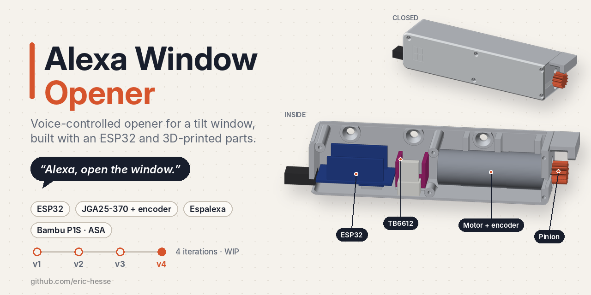

# 🪟 Alexa Window Opener

Voice-controlled opener for a tilt window ("Kippfenster"), built with an **ESP32**, a **DC gear motor with encoder** and **3D-printed parts**.

> 🚧 **Work in progress.** Every design iteration is a commit, and the versions are tagged `v1` to `v4`.



<p align="center">
  <a href="https://github.com/eric-hesse/alexa-window-opener/releases/tag/v1"></a>
  <a href="https://github.com/eric-hesse/alexa-window-opener/releases/tag/v2"></a>
  <a href="https://github.com/eric-hesse/alexa-window-opener/releases/tag/v3"></a>
  <a href="https://github.com/eric-hesse/alexa-window-opener/releases/tag/v4"></a>
</p>

<p align="center"><a href="https://eric-hesse.github.io/alexa-window-opener/"><b>🧊 View the interactive 3D model</b></a> &nbsp;·&nbsp; switch between v1–v4 right in the viewer</p>

## 💡 Idea

A motor unit is mounted on the wall/frame and drives a rigid **rack** that tilts the window open and pulls it closed again. A rack can both push and pull, unlike a cable. Locking the window handle stays manual on purpose; the device only tilts.

Goal: *"Alexa, open the window."*

## 🧭 Versions

| Version | Date | What changed |
|---|---|---|
| `v1` | 2026-10-08 | Faulhaber 2232U009SR motor, printed gear train (13/22/9/60 teeth, about 14.7:1) |
| `v2` | 2026-10-09 | Revised lid, first firmware (Alexa test + OTA update), print instructions |
| `v3` | 2026-10-13 | Switched to a JGA25-370 gear motor with encoder: pinion directly on the shaft, no printed gearbox |
| `v4` | 2026-10-13 | Compact housing, only 3.7 cm from the wall; electronics lie flat, rebated lid, hidden wall screws |

## 🔧 Hardware (current, v4)

| Part | Details |
|---|---|
| Microcontroller | ESP32 DevKit |
| Motor | JGA25-370, 6 V, 35 rpm, with encoder |
| Motor driver | TB6612FNG |
| End stops | Magnets + Hall sensor |
| Printed parts | Housing, lid, pinion, printed on a Bambu Lab P1S in Prusament ASA |

## 🛡️ Safety (planned)

The window must never hurt anyone or damage itself, so the device should:

- check that the handle is in the tilt position before moving
- detect obstacles (e.g. a finger in the gap) through motor current / encoder stall detection and stop or reverse immediately
- stop reliably at both end positions

## 🗺️ Roadmap

- [x] Concept & drive mechanism (rack instead of cable)
- [x] Bench test of the first motor with a lab power supply
- [x] Housing iterations v1 to v4
- [x] Firmware base: Wi-Fi setup portal, Alexa device, OTA update
- [ ] Motor control with encoder and end stops
- [ ] Obstacle detection & safety logic
- [ ] Mount on the real window & long-term test

## 📁 Repository structure

```
cad/        my own printable parts (lid, pinion) + assembly_v4.stl (opens in GitHub's 3D viewer)
docs/       print & assembly instructions (German), renders, and the 3D viewer page (docs/index.html)
firmware/   ESP32 code (PlatformIO, Arduino framework)
scripts/    Python scripts that generate and check the parts
```

## 🙏 Credits & license note

The mechanical concept (hook and rack) comes from the model **["Automatic window open/close er"](https://cults3d.com/de/modell-3d/werkzeuge/automatic-window-open-close-er) by hajnyondra** on Cults3D. That model is published under the *Cults Private Use* license, so its files and the housing parts that contain its geometry are **not** included in this repository. Get the original from the author if you want to build this. The generator scripts expect the original files locally.
